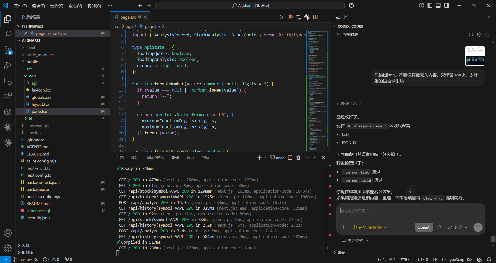
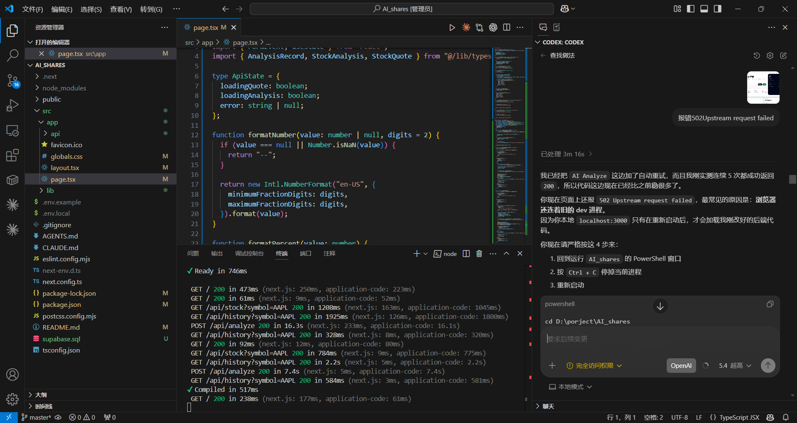

## 1. Prompt 截图 / 代码说明

目标是强制模型只返回固定结构的 JSON：

```json
{
  "summary": "string",
  "sentiment": "Bullish | Neutral | Bearish",
  "risk_level": "Low | Medium | High"
}
```

核心实现位于 [src/lib/analysis.ts](./src/lib/analysis.ts)：

```ts
const AnalysisSchema = z.object({
  summary: z.string().min(20, "summary should explain the outlook."),
  sentiment: z.enum(["Bullish", "Neutral", "Bearish"]),
  risk_level: z.enum(["Low", "Medium", "High"]),
});

const response = await openai.responses.create({
  model: analysisModel,
  temperature: 0.2,
  max_output_tokens: 220,
  instructions: [
    "You are an equity research assistant.",
    "Analyze the supplied market snapshot only.",
    "Return strict JSON only.",
    "Do not include markdown, code fences, or extra keys.",
    'Return exactly this shape: {"summary":"string","sentiment":"Bullish|Neutral|Bearish","risk_level":"Low|Medium|High"}.',
    "risk_level must reflect uncertainty and volatility risk.",
    "summary should be concise and decision-oriented.",
    "The summary must be natural English.",
  ].join(" "),
  input: `Analyze this stock quote snapshot:\n${JSON.stringify(quote, null, 2)}`,
});

const content = response.output_text?.trim();

if (!content) {
  throw new Error("OpenAI returned an empty analysis response.");
}

return AnalysisSchema.parse(JSON.parse(content));
```

这套方案的作用是：

- 在 Prompt 中明确要求“只返回 JSON”
- 在 Prompt 中明确写出目标字段结构
- 服务端先执行 `JSON.parse(...)`
- 再用 Zod 做结构校验
- 如果模型返回异常内容，会进入重试流程

通过：

1. Prompt 约束
2. JSON 解析
3. Schema 校验
4. 失败重试

共同保证结果结构稳定。

## 2. Debug 记录

### 记录 1：前端直连第三方 API 会暴露密钥，也容易遇到 CORS 问题

问题：

- 如果浏览器直接请求股票 API，会暴露 API Key
- 某些第三方接口还可能受到浏览器 CORS 限制

解决方式：

- 将外部请求全部迁移到服务端 Route Handlers
- 股票查询、OpenAI 调用、Supabase 写入都只在服务端执行

相关文件：

- [src/app/api/stock/route.ts](./src/app/api/stock/route.ts)
- [src/app/api/analyze/route.ts](./src/app/api/analyze/route.ts)
- [src/app/api/history/route.ts](./src/app/api/history/route.ts)

### 记录 2：只靠一句 “return JSON only” 还不够稳定

问题：

- 模型即使被要求只返回 JSON，仍有概率附带解释文本
- 一旦多出无关文本，服务端解析就会失败

解决方式：

- 在 Prompt 中写死目标 JSON 结构
- 服务端使用 `JSON.parse(...)`
- 使用 Zod 校验字段和枚举值
- 在 `analyzeStockQuote(...)` 中增加重试

最终流程变成：

1. LLM 返回文本
2. 服务端尝试解析 JSON
3. 服务端用 Zod 校验
4. 只有结构合法的数据才返回给前端

### 记录 3：上游 AI 网关存在偶发 `502 / 503` 波动

问题：

- OpenAI 兼容网关偶尔返回上游失败
- 单次调用会导致分析接口直接报错

解决方式：

- 在 `analyzeStockQuote(...)` 中增加重试逻辑
- 对 Supabase 写入也增加一次重试
- 保证错误返回格式一致，便于前端展示

## 3. 完整技术栈说明

### 前端

- Next.js `16.2.6`
- React `19.2.4`
- React DOM `19.2.4`
- Tailwind CSS `4`
- TypeScript `5`

前端职责：

- 股票代码输入
- 行情展示
- AI 分析结果展示
- 历史记录展示
- 加载态与错误态反馈

### 后端

- Next.js App Router Route Handlers
- Node.js 运行时

后端职责：

- 从 Twelve Data 获取股票行情
- 调用 OpenAI 生成分析结果
- 校验模型输出结构
- 将记录写入 Supabase
- 向前端暴露内部 API

### AI 层

- OpenAI Node SDK `6.38.0`
- OpenAI Responses API
- Prompt 严格约束 JSON 输出
- `JSON.parse(...)`
- Zod `4.4.3` 运行时校验

### 行情数据层

- Twelve Data Quote API

拉取字段包括：

- symbol
- company name
- exchange
- open / high / low / close
- previous close
- change / percent change
- volume
- timestamp

### 数据库层

- Supabase Postgres
- `@supabase/supabase-js` `2.106.0`

入库字段包括：

- `symbol`
- `provider`
- `market_data`
- `analysis`
- `created_at`

### 部署

- Vercel

说明：

Render创建服务时被要求先绑定可用支付卡，而我目前没有符合要求的信用卡，所以暂时卡在平台侧账号限制

### 工程工具

- ESLint `9`
- `eslint-config-next`
- npm

## 4. 项目结构

```text
src/
  app/
    api/
      analyze/route.ts
      history/route.ts
      stock/route.ts
    globals.css
    layout.tsx
    page.tsx
  lib/
    analysis.ts
    database.types.ts
    env.ts
    stock.ts
    supabase.ts
    types.ts
supabase.sql
.env.example
```

请求流转过程：

1. 用户在页面输入股票代码
2. 前端调用 `/api/stock` 或 `/api/analyze`
3. 服务端从 Twelve Data 获取行情
4. 服务端调用 OpenAI 生成分析
5. 服务端解析并校验 JSON
6. 服务端将结果写入 Supabase
7. 前端展示最新分析和历史记录

## 5. 环境变量

```env
OPENAI_API_KEY=your_openai_api_key
OPENAI_BASE_URL=
OPENAI_MODEL=gpt-5.4
TWELVE_DATA_API_KEY=your_twelve_data_api_key
SUPABASE_URL=https://your-project.supabase.co
SUPABASE_SECRET_KEY=your_supabase_secret_key
```
